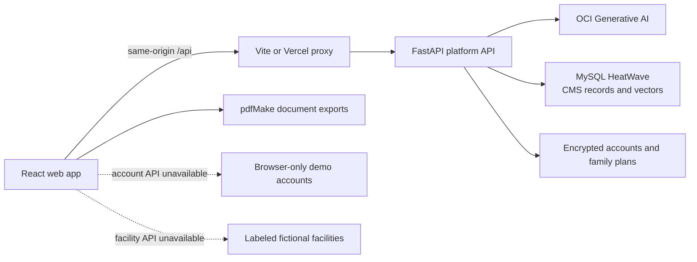

# Carebridge

Carebridge is an API-backed nursing home research and transition-planning prototype for family caregivers. It combines guided care-needs intake, Tennessee CMS Care Compare records, family-controlled facility matching, OCI-assisted drafts, shared family plans, transition checklists, and printable move-in documents in one responsive workspace.

**Live app:** [rimme-hacktn26.vercel.app](https://rimme-hacktn26.vercel.app)

This repository contains the React web client. It connects to a separately deployed FastAPI platform API backed by OCI services and MySQL HeatWave. The normal experience uses encrypted server accounts so a family can open and update the same plan across devices. If the account or facility API is unavailable, Carebridge keeps a browser-only demo mode and clearly labeled fictional facility data available.

> Carebridge is a design and engineering prototype, not a medical-record system, benefits determination service, admission system, or source of medical advice. Use invented information only.

## Platform architecture



- **Web application:** React 19 and Vite 8 provide the intake, facility research, family collaboration, transition plan, and accessible responsive interface.
- **Platform API:** browser requests use same-origin `/api`. OCI credentials and account secrets remain on the server and are never placed in client code or `VITE_` variables.
- **Facility data:** the connected experience uses Tennessee CMS Care Compare records exposed by the API, including ratings, staffing, citations, penalties, and source-aware facility details.
- **AI-assisted drafts:** the API supplies a plain-language care explainer, questions for the care team, facility-record Q&A, and an optional Know Me draft. Generated content is labeled for review.
- **Search and retrieval:** the platform architecture uses MySQL HeatWave for CMS data and vector search. The backend implementation is deployed separately and is not included in this repository.
- **Accounts and sync:** server accounts use an HttpOnly same-origin session cookie. Shared plans autosave, poll for family updates, and merge concurrent changes from different devices.
- **Documents:** branded PDFs are generated in the browser with pdfMake and are not uploaded as finished documents.

## What the app does

### Guided transition planning

Carebridge records the person’s current setting, daily support needs, mobility, memory and communication considerations, family priorities, coverage questions, and optional Know Me details. Families can revise those answers later from **My preferences**.

The starting-point screen turns the recorded answers into discussion prompts, a plain-language care explainer, questions for the care team, and a personalized move-in checklist. It does not determine a care level or coverage eligibility.

### Nursing home research

The facility explorer loads CMS-backed records through the platform API or uses labeled fictional fallback records when the API is unavailable. Families can:

- search near a Tennessee city or ZIP code;
- filter and sort facilities;
- inspect ratings, staffing, citations, fines, and source notes;
- ask questions grounded in one facility’s CMS record;
- save a shortlist and compare homes side by side;
- download a branded comparison PDF.

Real CMS facilities receive a transparent 0–100 match score when enough data is available. The score uses the family’s importance sliders, recorded support needs, travel range, and available CMS measures. Missing data is omitted rather than treated as zero. Costs, Medicaid acceptance, room types, languages, and memory-care availability are not scored because CMS does not provide those fields consistently.

### Shared family planning

The Family tab stores names, relationships, phone numbers, email addresses, task assignments, and whether a contact should appear on the nursing-home handoff sheet. The plan owner can create an invitation link and eight-character code for a family member.

With server accounts, the invited person creates their own account and joins the same encrypted family plan from any device. The owner can cancel pending invitations, and each linked person can maintain their own contact details. In browser-only mode, invitation codes are simulated and work only in the browser that created them.

The shared plan saves after changes, checks for updates every 15 seconds and when the tab regains focus, and merges concurrent edits. The current screen remains device-specific so one family member’s navigation does not move everyone else.

### Transition workspace and downloads

The transition workspace includes an assignable checklist, document and packing lists, family contacts, a selected nursing home, and a Downloads tab. **Download full plan** creates the available files in the move-in packet:

- transition plan;
- resident information for the nursing home;
- Know Me profile;
- printable move-in checklist and packing list;
- questions to ask;
- nursing home comparison when at least two homes are saved.

Each document can also be downloaded separately. The resident handoff sheet includes only family contacts marked for the nursing home, repeats what the family recorded, leaves space for medical information the app does not collect, and excludes the family’s budget and priority weights.

### Accessibility

The interface includes keyboard-operable controls, visible focus states, labeled groups and dialogs, reduced-motion support, responsive layouts, guided help, and selectable Standard, Protanopia, Deuteranopia, and Tritanopia color palettes. The facility comparison and match-score visuals retain text labels and exact values for nonvisual interpretation.

## Accounts and plan persistence

At startup, the client checks `GET /api/auth/me` with a four-second timeout and selects one of two account stores through `src/lib/account-store.js`.

### Server accounts

Server accounts are the normal deployed mode:

- sign-up and sign-in use the account API and an HttpOnly same-origin cookie;
- passwords require at least 10 characters, and this prototype has no password reset;
- the encrypted family plan opens on every signed-in device;
- saves are versioned, retried, and merged through `plan-sync.js` and `plan-merge.js`;
- the header reports saving, saved, offline, and failed states;
- only the plan owner can invite family members;
- any person can delete their own account, while deleting the owner removes the shared plan and access for everyone.

### Browser-only demo accounts

If the account service is unavailable, outdated, or disabled, the app automatically uses the original local demo account implementation. Password fields are simulated and are not checked, stored, or sent. Plans and invitation codes remain limited to the current browser and origin.

Browser-only mode uses these localStorage keys:

- `carebridge-demo-accounts-v1` for local demo accounts, invitations, and the active session;
- `carebridge-demo-plan:<email>` for each local account’s plan;
- `carebridge-prototype-v1` for older unlinked drafts;
- `carebridge-last-page-v1` for device-specific navigation;
- `carebridge-color-vision-v1` for the selected accessibility palette.

Different localhost ports are different origins. Clear site storage to remove browser-only demo state.

## Run the web client locally

### Requirements

- Node.js 22.12 or newer
- npm

Install dependencies and start the development server:

```sh
npm ci
npm run dev
```

Open the Local URL printed by Vite. Run commands from the repository root.

Vite sends same-origin `/api` requests to the configured backend. The checked-in default is the team’s HTTPS API. To use a local backend, create `.env.local`:

```dotenv
API_PROXY_TARGET=http://127.0.0.1:8000
```

The local API must allow HTTP explicitly. See the backend repository’s `ACCOUNTS.md` for its `CB_ALLOW_HTTP` setting.

Optional client configuration:

```dotenv
# Send the browser directly to a public HTTPS API instead of same-origin /api.
VITE_API_URL=https://api.example.com

# Change how often a signed-in device checks for family updates.
VITE_SYNC_POLL_MS=15000
```

If `VITE_API_URL` is set, that API must allow the deployed web origin and support the account cookie configuration. Same-origin `/api` is the preferred setup.

## Production build and deployment

```sh
npm run build
npm run preview
```

`npm run build` writes the production client to the ignored `dist/` directory. `npm run preview` serves that build for local verification only.

The public client is hosted on Vercel. `vercel.json` forwards `/api/*` to the team’s HTTPS FastAPI deployment, keeping browser traffic on the website’s origin and avoiding mixed-content or cross-site-cookie problems.

For another deployment, serve `dist/` as a static application and either:

1. reverse-proxy same-origin `/api` requests to the FastAPI service, or
2. set `VITE_API_URL` at build time to a compatible HTTPS API.

## API surface used by the client

Facility, intake, and AI requests in `src/lib/api.js`:

```text
GET    /facilities
GET    /facilities/:ccn
POST   /facilities/:ccn/ask
POST   /intake
PATCH  /tasks/:id
POST   /plans/:planId/know-me
```

Account, family, and sync requests in `src/lib/cloud.js`:

```text
GET           /auth/me
POST          /auth/signup
POST          /auth/login
POST          /auth/logout
POST          /auth/join
PATCH, DELETE /auth/me
GET, PUT      /plan
GET           /plan/family
POST          /plan/invites
DELETE        /plan/invites/:code
GET           /invites/:code
```

`src/lib/api-model.js` translates between the planning UI and API payloads, adapts CMS facility records, and calculates the family-specific facility score from server-provided components.

## Quality checks

```sh
npm test
npm run lint
npm run build
```

The Node test suite covers API adapters, account-store selection, browser and server account behavior, family invitations, cross-device plan merging and sync, local draft migration, personalized scoring, facility comparison, checklist generation, packet contents, PDF privacy boundaries, and stable filenames. ESLint checks the application source, and the production build verifies the complete client bundle.

## Project layout

```text
src/
  App.jsx                         Application flow, API orchestration, and state
  main.jsx                        React entry point
  styles.css                      Responsive, accessible, and color-vision styles
  components/
    CarebridgeLogo.jsx            Shared Carebridge brand mark
    FacilityLive.jsx              CMS facility overview, inspections, and Q&A
    FacilityComparison.jsx        Accessible shortlist comparison dialog
    FamilyUI.jsx                  Family contacts, invitations, and join forms
    PrioritySliders.jsx           Family-controlled match-score weights
    ScoreUI.jsx                   Match score and calculation explanation
    Welcome.jsx                   Landing and account entry experience
  data/
    demo.js                       Example person and Know Me content
    packing.js                    Shared packing-list definitions
    prototype.js                  Clearly labeled fictional fallback facilities
  lib/
    api.js                        Facility, intake, task, and AI API client
    api-model.js                  API adapters and personalized facility scoring
    cloud.js                      Server account, plan, family, and invite client
    account-store.js              Shared interface over server and local accounts
    demo-accounts.js              Browser-only account and invite fallback
    demo-model.js                 Plan persistence, migration, filters, and summaries
    family.js                     Contact details, invite codes, and links
    plan-merge.js                 Concurrent family-plan merge rules
    plan-sync.js                  Versioned autosave, polling, and retry behavior
    priorities.js                 Priority topics, weights, and migration
    facility-comparison.js        Shared comparison rows and formatting
    comparison-document.js        Nursing home comparison PDF
    plan-document.js              Transition plan and shared PDF branding
    packet-documents.js           Handoff, checklist, packing, and question PDFs
    packet-meta.js                Packet availability and download metadata
    plan-pdf.js                   Lazy pdfMake loading and browser downloads
public/
  favicon.svg                     Carebridge browser icon
vercel.json                       Production /api rewrite
vite.config.js                    Vite build and development API proxy
.env.example                      API and sync configuration examples
```

## Prototype boundaries

- Confirm current facility information directly with the nursing home and Medicare Care Compare.
- The match score summarizes public data and recorded preferences. It does not predict care quality, availability, eligibility, or admission.
- The account system is a prototype with no password reset and is not approved for protected health information.
- Use made-up names, contact details, and care information.
- A production release would require reviewed security, privacy, consent, retention, accessibility, account recovery, audit, and healthcare-compliance controls across both the client and the separately deployed API.
